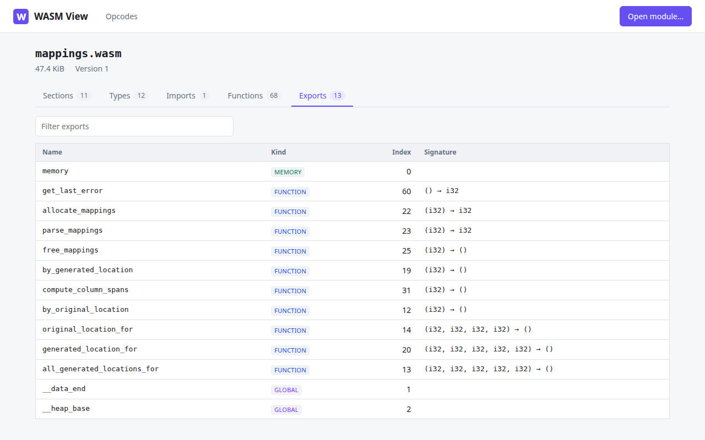
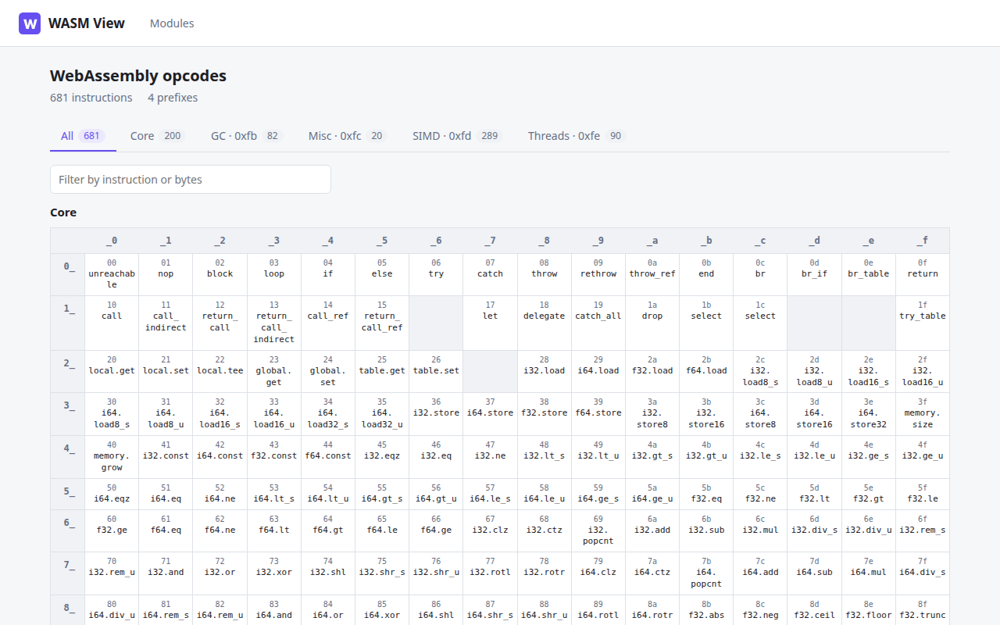

# WASM View

WASM View is a small web application for inspecting WebAssembly modules. Upload a `.wasm` file and it shows the module's sections, function types, imports, functions and exports, with a hex preview of every section. An Opcodes page lists every WebAssembly instruction in a chart laid out like an ASCII table.

<picture>
  <source srcset="src/public/screenshots/module_dark.png" media="(prefers-color-scheme: dark)" />
  
</picture>

The module is parsed on the server by a [libnetq](https://github.com/yacubin/libnetq) web module (`wasmview_wla`) using `libnetq/wasm/Module.h`. The browser UI is a React + TypeScript app built with Vite.

## Quick start

Requirements: Node.js and npm, CMake 3.8+, a C compiler, and the usual tools to build the bundled third-party libraries (make, perl for OpenSSL).

```sh
npm install
npm run bitmake   # builds zlib, OpenSSL, civetweb, jansson, libnetq and this project into build/package
npm run server    # starts build/package/bin/wasmview_server
```

Open <http://localhost:8033/> and drop a `.wasm` file on the page. The opcode chart is at <http://localhost:8033/opcodes>.

## UI development

```sh
npm run dev
```

starts the Vite dev server. Requests to `<base-url>/modinfo` are proxied to a running `wasmview_server` at `http://localhost:8033`; pass `--server-url=<url>` to use another one:

```sh
npm run dev --server-url=http://localhost:9000
```

`npm run build` type-checks the sources and writes the client to `dist/`:

| File | Purpose |
| --- | --- |
| `index.html`, `index.js`, `index.css`, `favicon.svg` | The client application |
| `opcodes.html`, `opcodes.js` | The Opcodes page, built only with `--opcodes` (see below) |
| `logo_wla.svg`, `screenshots/*.png` | Images listed as screenshots in the server catalog |
| `manifest.json` | Read by `wasmview_wla` to serve the files above and register the app in the server catalog; generated from `package.json` (name, version, description) |

## Opcodes page

The opcode list comes from libnetq's `libnetq/wasm/Opcodes.def`. The `opcodes` tool (`opcodes.c`) writes it as a JSON array of `{ "name", "wat", "code" }` objects, and the build reads that file:

```sh
npm run build --opcodes=build/bundle/output/bin/opcodes.json
npm run dev --opcodes=build/bundle/output/bin/opcodes.json
```

Without `--opcodes`, or when the file does not exist, the page is not built and the header does not link to it. A file that is not a valid, non-empty opcode list fails the build.

Prefixed instructions are split into the prefix byte (`0xfb` GC, `0xfc` Misc, `0xfd` SIMD, `0xfe` Threads) and the sub-opcode, which is shown as LEB128 bytes.

<picture>
  <source srcset="src/public/screenshots/opcodes_dark.png" media="(prefers-color-scheme: dark)" />
  
</picture>

## Base URL

The app can be served under a URL prefix. Pass it to npm as `--base-url`; every URL the client uses, including the API, gets the prefix:

```sh
npm run build --base-url=/tools/wasmview
npm run dev --base-url=/tools/wasmview
```

When the base URL is not `/`, the header shows a Home link to `/`. The module page is served at the base URL without its trailing slash (`/tools/wasmview`), and the Opcodes page at `<base-url>opcodes`.

The server side takes the same prefix from the `WASMVIEW_BASE_URL` CMake option and passes it to `npm run build`, so a CMake build keeps both sides in sync.

## Building with CMake

`CMakeLists.txt` builds the `wasmview_wla` module, the `wasmview_server` executable and the `opcodes` tool. It runs `opcodes` to generate `opcodes.json` in the build directory, then runs `npm install` and `npm run build --opcodes=<build-dir>/opcodes.json` for the client. It needs an installed libnetq (`find_package(LibNetQ)`).

```sh
cmake -S . -B build/cmake \
  -DCMAKE_MODULE_PATH=<libnetq-prefix>/share/libnetq/cmake \
  -DCMAKE_PREFIX_PATH=<libnetq-prefix> \
  -DWASMVIEW_BASE_URL=/tools/wasmview
cmake --build build/cmake
cmake --install build/cmake --prefix <install-prefix>
```

| Option | Default | Description |
| --- | --- | --- |
| `WASMVIEW_BASE_URL` | `/` | URL prefix the module is served under |
| `WASMVIEW_INSTALL_SERVER` | `ON` | Install `wasmview_server` to `bin/` |
| `WASMVIEW_INSTALL_MODULE` | `ON` | Install `wasmview_wla` to `bin/` |
| `WASMVIEW_INSTALL_ASSETS` | `ON` | Install `dist/` to `share/wasmview-wla/` |

`wasmview_server` listens on `localhost:8033` and loads the `wasmview` executor, which libnetq resolves to the `wasmview_wla` module. The module finds its assets at `../share/wasmview-wla/manifest.json` relative to its own location.

## HTTP API

### `POST <base-url>/modinfo`

The request body is the raw `.wasm` file (`Content-Type: application/wasm`), up to 64 MiB. The response is JSON:

```json
{
  "size": 98,
  "version": 1,
  "sections": [
    { "id": 1, "name": "Type", "offset": 10, "size": 10, "count": 2 },
    { "id": 0, "name": "Custom", "offset": 74, "size": 24, "customName": "producers" }
  ],
  "types": [{ "params": ["i32", "i32"], "results": ["i32"] }],
  "typesComplete": true,
  "imports": [{ "module": "env", "name": "log", "kind": "function", "type": 1 }],
  "functions": [0],
  "memories": [],
  "exports": [{ "name": "add", "kind": "function", "index": 1 }]
}
```

- `sections[].offset` and `sections[].size` locate each section's payload in the uploaded file. The section bytes are not included; the client reads them from its own copy of the file for the hex preview.
- `functions` lists the type index of each function defined in the module; imported functions come first in the function index space.
- `start` is present when the module has a start function.

Errors return `400` (not a valid module, empty body), `413` (larger than 64 MiB) or `500`, with a body of the form `{ "error": "<message>" }`.

## Project layout

| Path | Contents |
| --- | --- |
| `src/` | Client sources (React + TypeScript): `index.html` / `App.tsx` for modules, `opcodes.html` / `OpcodesApp.tsx` for opcodes |
| `src/public/` | Static files copied to `dist/`: `favicon.svg`, `logo_wla.svg`, `screenshots/` |
| `module.c` | `wasmview_wla` web module: static files from `manifest.json` and the `modinfo` endpoint |
| `server.c` | Minimal `wasmview_server` that loads the module |
| `opcodes.c` | Build-time tool that writes the opcode list as JSON |
| `config.h.in` | URLs and asset paths configured by CMake |
| `vite.config.ts` | Base URL handling, dev proxy, opcode list loading and `manifest.json` generation |
| `bitmake.config.mjs` | Recipe for `npm run bitmake` |

## Known limitations

These come from libnetq 1.0.19:

- Imported table limits are reported shifted: the minimum is read from the limits flag byte, so a table with a minimum of 7 and no maximum shows as `min 0, max 7`. A module importing a table that has a maximum fails to parse.
- Modules that import a global of a reference type (`funcref`, `externref`) are rejected.
- Non-ASCII characters in names are escaped byte by byte in the JSON response and display garbled.

The Types tab decodes plain function types only and stops at the first GC or recursive type.

## License

[MIT](LICENSE)
